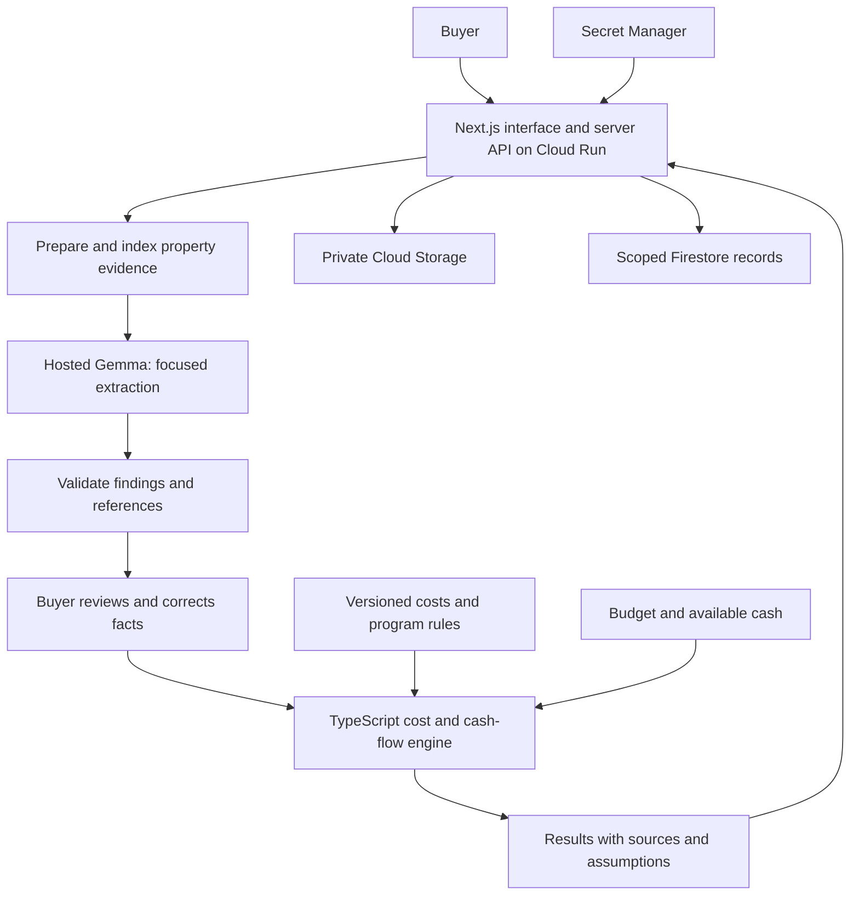

# How TrueCost Home works

Selected direction: **Next.js + TypeScript on Google Cloud**, with hosted Gemma inference. This document describes the planned application; no application code, cloud resources, or model integration has been implemented yet.

## The pieces

| Piece | Responsibility |
|---|---|
| Next.js + React | Property intake, evidence review, budget scenarios, and results |
| Next.js Route Handlers | Server endpoints for uploads, extraction, validation, calculations, and saved analyses |
| TypeScript + Zod | Shared data contracts with runtime validation at every external boundary |
| Gemma provider adapter | Sends bounded property evidence to the configured Gemma endpoint and records model usage |
| Pure TypeScript engine | Calculates ownership costs, repair cash timing, and program screening without model calls |
| Versioned JSON data | Sourced repair scopes, cost ranges, and assistance-program rules |
| Cloud Run | Hosts the Next.js application as a container |
| Cloud Storage | Holds private uploaded photos, PDFs, and temporary derivatives |
| Firestore | Stores session-scoped analysis records, provenance, and revisions |
| Secret Manager | Holds model credentials for server-side access |

Next.js supplies both the interface and backend. We do not need FastAPI or a separate Python service for this scope. Hosting the application on Cloud Run does not itself host Gemma. The model is accessed through a separately verified endpoint; self-hosted GPU inference is deferred.

Official references: [Next.js Route Handlers](https://nextjs.org/docs/app/getting-started/route-handlers), [Gemma API](https://ai.google.dev/gemma/docs/core/gemma_on_gemini_api), [Cloud Run](https://cloud.google.com/run/docs/overview).

## System map



Household finances do not enter property-analysis prompts. The server owns authoritative calculations; the browser displays them. Model credentials never reach browser bundles.

## 1. Prepare the evidence

Accept listing text, up to six supported photos, property facts with sources, and a bounded inspection PDF. The first PDF implementation handles text-based reports while preserving page numbers and exact text spans. Scanned reports require explicit OCR support; otherwise show an unsupported-input state rather than pretending extraction succeeded.

Validate actual file type, size, page count, and image dimensions. Keep the original source IDs when extracting text or preparing image derivatives. Associate images with rooms when supplied; flag unreadable labels, poor image quality, and missing views. Choose a maintained PDF parser and explicit upload limits during implementation and record them in setup documentation.

Treat uploaded text as data, never as permission to change the workflow or run external actions. Remove unnecessary metadata and minimize personal information before model requests.

## 2. Focused Gemma extraction

Use a fixed checklist for roof, HVAC, plumbing, electrical, and moisture concerns, with reviewed examples. Ask for findings, supporting evidence, unresolved questions, and unassessed components. Separate reported inspection findings from visual suspicions and user assumptions.

Example internal finding:

```json
{
  "id": "finding_1",
  "component": "ceiling",
  "description": "Visible dark discoloration",
  "evidence_class": "visual_observation",
  "evidence": [{"source_id": "photo_2", "kind": "image"}],
  "needs_professional_assessment": true,
  "follow_up_question": "Has the source of the discoloration been assessed?"
}
```

For report findings, evidence includes a page number and exact quotation. Do not invent precise probabilities, hazard diagnoses, failure dates, or replacement scopes from a photo. A ceiling stain alone does not establish a roof replacement need.

The adapter records provider, exact model ID, prompt version, latency, usage when available, and response status. The first milestone verifies image input and structured response handling against the actual endpoint. Calling a Gemini-branded SDK is not proof that the selected model is Gemma.

## 3. Validate and review

Shared Zod schemas validate types, permitted evidence classes, ranges, and required fields. Check that source IDs exist, page numbers are valid, and quoted text matches the indexed report, with documented whitespace normalization. Preserve the original span for display. Flag conflicting ages or findings without silently choosing one source.

Format validation and quotation matching do not establish semantic correctness. Visual claims still need review. Reject unsupported certainty, leave missing information unknown, and require buyer review of material assumptions before finalizing the budget. Users can open the cited page or image and correct facts while preserving their original source and revision history.

Malformed model output gets at most one repair retry, then an explicit failure. A failure must never turn into a clean inspection result.

## 4. Retrieve sourced costs and assistance rules

Use a small versioned JSON catalog. Each repair record includes scope, unit, quantity assumptions, geography, low/central/high costs, exclusions, source, date, and reuse terms. The backend maps confirmed scopes to records; speculative causes remain conditional scenarios. Missing local coverage stays visible.

Program records contain official links, verification dates, permitted uses, eligibility criteria, unknown criteria, and intake/funding status. Screen using explicit code and user-supplied facts. Do not let model prose approve eligibility or add unconfirmed funding to the baseline.

Reference retrieval supplies facts; it does not train Gemma to recognize defects. Start with direct lookups and filters. A vector database is unnecessary for a small catalog.

## 5. Calculate in TypeScript

Keep financial functions independent of Next.js, cloud services, and Gemma so they can be tested offline. Share schemas and types, not duplicated financial implementations.

Calculate mortgage payments, entered ownership expenses, cash after closing and protected savings, immediate repair gaps, and monthly repair balances over 60 months. Use integer cents or a deliberate decimal-arithmetic library with documented rounding. Handle zero interest, no loan, missing costs, and double-counting explicitly.

A $12,000 repair at month 60 and the same repair at closing have different cash implications. Future savings cannot cover an immediate shortfall. Never use an average repair allowance alone as an affordability verdict.

Changing budget inputs reruns calculations without another model call. A change to property evidence invalidates only the extraction and dependent calculations that need updating.

## 6. Explain and expose evidence

Render source links, editable assumptions, cost ranges, cash gaps, missing information, and targeted follow-up questions. Every displayed dollar amount comes from validated calculation data. An optional bounded Gemma call can explain findings and computed facts; deterministic templates remain the fallback.

Avoid a reassuring verdict when material costs are unknown. Label illustrative data, cached extraction, and live calls accurately.

## API and data contracts

Planned same-origin endpoints:

- `POST /api/analyses`: validate intake and create a session-scoped analysis.
- `POST /api/analyses/:id/extract`: process authorized property evidence and validate findings.
- `PATCH /api/analyses/:id/facts`: record reviewed corrections and revisions.
- `POST /api/analyses/:id/calculate`: calculate scenarios and screen program rules.
- `GET /api/analyses/:id`: retrieve authorized results and provenance.
- `DELETE /api/analyses/:id`: delete the scoped record, uploads, derivatives, and cached analysis.

These are proposed contracts, not implemented endpoints. Each server operation checks session ownership; an opaque analysis ID alone is not authorization. Shared Zod schemas define runtime contracts and inferred TypeScript types. Record input, prompt, model, cost-data, program-data, and calculation versions with results.

## Google Cloud operation

Deploy one Next.js container on Cloud Run. Use a service identity with only the required bucket, database, and secret permissions. Keep uploads private; use short-lived scoped access when needed. Do not commit credentials or real buyer records.

Start with bounded extraction requests and measured timeouts. If document processing exceeds that budget, add Cloud Tasks and a protected worker endpoint with durable Firestore job state and idempotency. Do not start an untracked background task and assume Cloud Run will keep it running after the HTTP response ends.

Set upload, token, concurrency, and retry limits. Cache extraction within the authorized session using evidence hashes and model/prompt versions. Do not share private evidence caches across users. Budget edits reuse extraction. Track latency and cost per analysis; configure deployment limits before exposing the service.

Define retention and test deletion across uploads, derivatives, caches, and saved records. Application deletion does not establish the model provider's retention policy; document that separately.

Local development can use explicitly labeled fixtures and storage adapters. No Google Cloud resources or paid GPU deployment have been created by this plan.

## How we prove the pipeline helps

Compare a single basic prompt with the full pipeline on the same held-out examples, using the same model version. Keep development examples separate from evaluation cases. Include blurry images, ambiguous stains, absent views, readable labels, conflicting report statements, scanned PDFs, and instruction-like document text.

Report correct findings, missed findings, unsupported claims, evidence-reference correctness, abstentions, latency, and model usage. Record both raw extraction errors and errors that reach the final user result. A small team-labeled test set is a prototype evaluation, not professional inspection certification. Claim improvement only when measured.

Prompt examples and preprocessing may improve results without changing weights. Fine-tuning is deferred until labeled data and a measured failure pattern justify it. Paperclip, autonomous agent loops, and a separate model-training service are outside the MVP.

## How we build together

We share product, programming, architecture, and release decisions. Agree on an observable acceptance example for each slice, implement a small change, run relevant checks, and get a teammate's review. Frontend, pipeline, calculations, and source data can be divided by interest while using the same contracts.

Review questions: Where did the fact come from? What remains unknown? Does the evidence support the claim? Can the math run without the model? Does a correction recompute the right results? What is the measured cost per analysis?

## Foundation implementation status

The Next.js scaffold and initial shared contracts are implemented. See [the demo specification](DEMO_SPEC.md) and [Gemma wrapper implementation plan](GEMMA_WRAPPER.md). Firestore remains the chosen persistence service; persistence and accounts are deferred until after the first working analysis flow. The Gemma wrapper and analysis API are implemented; the calculator, storage and cloud deployment remain unimplemented. Current code uses camelCase fields; earlier JSON examples in this document are conceptual rather than exact wire contracts.
