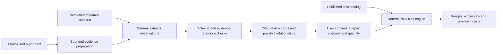

# Whole-home research and cost engine

Gemma interprets the supplied photos, listing text and report excerpts. A versioned library supplies building-science guidance; application code supplies citations, candidate relationships and prices. There is no training, web-browsing agent, property-value model, or personal house-rating dataset in this implementation.

## What the research adds

The library contains 49 indicators and six combinations of clues. It covers roof covering and penetrations; foundation and framing; attic moisture; heating, cooling and combustion; electrical and plumbing; kitchens, bathrooms and appliances; windows and exterior; drainage, trees and decks; pests, hazardous materials, septic and wells. The coverage response lists 27 property categories. A listed category is not a claim that all defects in that category are detectable. Garage, pool and other specialized safety assessments remain evidence gaps unless supported observations are supplied.

Each indicator has an observable sign, alternative explanations, a professional verification step, a priority and source IDs. The priority is an application triage rule, not a calibrated failure probability. Photos cannot establish smells, heat, electrical loading, moisture content, structural capacity, contaminant identity or concealed damage. Equipment age supports planning questions, not a predicted failure date.

The six candidate relationships are runoff/basement moisture, roof/ceiling staining, exhaust/attic moisture, plumbing/cabinet or floor damage, foundation/interior movement, and airflow/cooling ice. Every candidate names its supporting findings and is labeled a hypothesis. Matching labels does not establish that two observations concern the same location, time or cause.

Primary technical references include [DOE/PNNL existing-home assessments](https://basc.pnnl.gov/existing-homes), [EPA moisture guidance](https://www.epa.gov/indoor-air-quality-iaq/remodeling-your-home-and-indoor-air-quality), [CPSC electrical guidance](https://www.cpsc.gov/s3fs-public/513.pdf), [InterNACHI's inspection scope](https://www.nachi.org/sop.htm), and [University of Maryland tree guidance](https://extension.umd.edu/resource/how-do-you-decide-when-remove-tree). Technical reference age is recorded where known; a recent retrieval date does not mean recent publication. Historical guidance is not used as a current local code-compliance rule.

## How the backend uses it



Research is compiled into a bounded checklist in the system prompt. General guidance is not treated as evidence that a particular house has a defect. Evidence quote/source checks establish provenance, not semantic truth: a real quote can still be misinterpreted. Human review and the benchmark are necessary. No claim is made that the model detects things better than a qualified inspector.

## Cost provenance

The initial 15 scopes use published vendor planning ranges or posted prices. They are **not paid invoices, competitive bids, independent market averages or calibrated confidence intervals**. Most are Northern Virginia-specific; the tank-water-heater scope is explicitly national. Maryland/DC have no local fallback multiplier. Exact source records live in [sources.json](../web/src/data/sources.json); numbers and scope assumptions live in [cost-catalog.json](../web/src/data/cost-catalog.json).

| Source | Scope represented | Important limitation |
|---|---|---|
| [Rain Guard Roofs](https://rainguardroofs.com/blog/roof-repair-cost-northern-virginia/) | Five localized asphalt-roof repairs | Ordinary access and limited damage; no concealed structural repair ceiling |
| [SwiftPro](https://goswiftpro.com/hvac-replacement/) | Four HVAC replacement alternatives and diagnostic visit | Vendor-specific ranges; actual sizing and installation scope required |
| [Milcon](https://milcondesignandbuild.com/window-replacement-guide-northern-virginia/) | Standard vinyl double-hung window | Measured count and matching product/scope required |
| [Home Depot](https://www.homedepot.com/services/c/cost-install-water-heater/9058c024e) | Basic tank water-heater replacement | National fallback requires explicit acceptance |
| [myYardPros](https://myyardpros.com/water-management/french-drain-installation/) | Yard drainage scenario per measured foot | Design, lawful outlet and site conditions need assessment |
| [Rendon Remodeling](https://www.rendonremodeling.com/pricing/) | Elective kitchen and hall-bath remodels | Never used as the cost of a small leak, dated finish or necessary repair |

Prices use integer cents. The engine never accepts a price, percentage adjustment, repair quantity or market valuation from model output. It rejects duplicate/overlapping scopes, requires quantity and scope confirmation, blocks mismatched geography and flags catalog reviews older than 180 days. That review interval is application policy, not a price guarantee. The source publication date can be unknown even when the page was checked recently.

Unknown work remains `quote_required`; no price is invented for foundation underpinning, structural engineering, concealed rot, full roof replacement, remediation, rewiring, tree removal or other uncatalogued scopes. A subtotal of priced work is marked incomplete when requested work remains unpriced. Even a complete selected-scope estimate is not an exhaustive home repair budget.

Repair cost is not the same as resale-value impact. The response deliberately leaves `resaleValueImpact` null. A defensible property valuation would require comparable sales, location and market adjustments, a separate method and validation.

## API

`GET /api/estimate` lists published scopes with provenance. `POST /api/estimate` accepts at most 64 KiB of JSON, checks browser origin, and returns a deterministic estimate without invoking Gemma. From a terminal:

```sh
curl http://localhost:3000/api/estimate \
  -H 'Content-Type: application/json' \
  --data '{"region":"northern_virginia","items":[{"catalogId":"roof_pipe_boot","quantity":1,"scopeConfirmed":true}]}'
```

`scopeConfirmed` means the person selected that scenario and acknowledged its assumptions; it is not a claim that an inspector certified the repair. Quantities are whole units (projects, windows or linear feet), never inferred from a photo. One project is allowed per project-priced scope. Compare alternatives in separate requests. There is no whole-property area conversion.

`POST /api/analyze` adds `indicatorIds` to findings and `conditionReview` to the response. Review cards link to sources and optional cost-scope IDs. They never automatically select replacement or apply costs. `coverage` reports `no_evidence` or `observations_only`; neither is a safe/unsafe verdict. The existing six-image and 16,000-character input limits remain. Multiple rooms and systems can be included, but a submission is not an exhaustive inspection.

## Files

- `web/src/data/`: source registry, researched indicators, pattern rules and cost catalog.
- `web/src/lib/condition/knowledge.ts`: validates the research library and resolves citations.
- `web/src/server/model/prompt.ts`: supplies the checklist to Gemma.
- `web/src/server/condition/review.ts`: attaches cited explanations and cross-system candidates.
- `web/src/server/costs/engine.ts`: scope validation, geography, freshness and arithmetic.
- `web/src/app/api/estimate/route.ts`: cost API.
- `web/benchmarks/`: scenarios, educational photo manifest, runner and scoring.

The browser upload/results UI, PDF parsing, monthly affordability calculator, grant matching, Firestore and deployment remain separate milestones.
